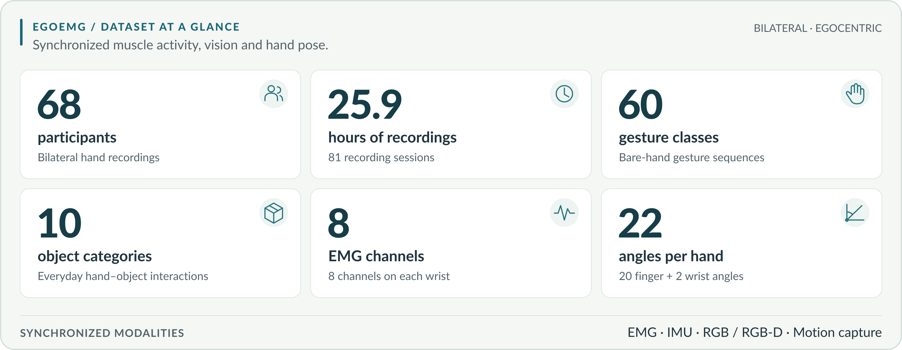

<h1 align="center">EgoEMG</h1>

<p align="center">
  A multimodal egocentric dataset with bilateral EMG and vision for hand pose estimation
</p>

<p align="center">
  <a href="https://zhenqis123.github.io/egoemg-site/">
    
  </a>
</p>

<p align="center">
  <a href="https://zhenqis123.github.io/egoemg-site/"></a>
  <a href="https://pan.baidu.com/s/1xBd7Ghwg0Uq9mce5mHRwKA?pwd=eg8m"></a>
  <a href="https://pan.baidu.com/s/1mzgVqJUaUrMezByxKI0Ktw?pwd=eg8m"></a>
  <a href="https://pan.baidu.com/s/1DMgtNnJdeTZNh1V975IBBQ?pwd=eg8m"></a>
</p>

<p align="center">
  <a href="#highlights">Highlights</a> ·
  <a href="docs/dataset/README.md">Dataset</a> ·
  <a href="#setup">Setup</a> ·
  <a href="#viewer">Viewer</a> ·
  <a href="#training">Training</a> ·
  <a href="#eval">Evaluation</a> ·
  <a href="docs/results.md">Results</a> ·
  <a href="#license-and-citation">Citation</a>
</p>

<a id="highlights"></a>

## ✨ Highlights

- **🤲 Diverse gestures and hand–object interactions.** Synchronized multimodal
  recordings span **68 participants, 60 bare-hand gesture classes and 10 object
  categories** across free-hand motion and object manipulation.
- **🔀 EMG–vision fusion for challenging visual conditions.** Muscle activity
  provides complementary cues when hands are occluded or visual evidence is
  ambiguous, improving hand-pose estimation beyond vision alone.

Dataset coverage and formats are described in the [dataset guide](docs/dataset/README.md)
and [field reference](docs/dataset/SCHEMA.md).

<a id="setup"></a>

## ⚙️ Setup

### Install

Run commands from the repository root. Install FFmpeg and ffprobe before
building video caches.

```bash
conda env create -f environment.yml
conda activate egoemg
python -m pip install -e '.[train,vision,viz]'
```

### Prepare assets

Download from Baidu Netdisk. The extraction code is **`eg8m`**.

| Resource | Download | Local directory under `$EGOEMG_ROOT/` |
|---|---|---|
| Demo subset (20 min, 10.35 GB) | [Baidu Netdisk](https://pan.baidu.com/s/1mzgVqJUaUrMezByxKI0Ktw?pwd=eg8m) | `data/EgoEMG_demo/` |
| EgoEMG V1 dataset | [Baidu Netdisk](https://pan.baidu.com/s/1xBd7Ghwg0Uq9mce5mHRwKA?pwd=eg8m) | `data/EgoEMG_dataset/` |
| Pretrained checkpoints (13 models) | [Baidu Netdisk](https://pan.baidu.com/s/1DMgtNnJdeTZNh1V975IBBQ?pwd=eg8m) | `pretrained_models/` |
| EMG2Pose corpus (optional) | [Baidu Netdisk](https://pan.baidu.com/s/1iBAwFsbgH8wcqvNcVrdTfg?pwd=eg8m) | `data/emg_corpus/emg2pose_v3_memmap/` |

> [!WARNING]
> **The legacy download is no longer supported.** The
> [old Baidu share](https://pan.baidu.com/s/1aG2e-mHJkmP4KiYtYRcReA) has expired,
> and its packages are incompatible with the current code and data format.
> Use the download links above.

For a quick start, follow the [demo workflow](docs/dataset/README.md#demo-subset):
download two 10-minute clips, open the viewer, and check training and inference.
The commands below use the full EgoEMG dataset.

Start with the EgoEMG dataset. Download EgoEMG checkpoints to evaluate pretrained
models.

Arrange the assets you need as follows:

```text
$EGOEMG_ROOT/
  data/EgoEMG_dataset/
  data/emg_corpus/emg2pose_v3_memmap/  # EMG2Pose only
  pretrained_models/egoemg/
  pretrained_models/emg2pose/        # EMG2Pose only
  pretrained_models/markers2mano/    # marker conversion only
```

```bash
export EGOEMG_ROOT=/path/to/egoemg_assets
export EGOEMG_CHECKPOINT_ROOT="$EGOEMG_ROOT/pretrained_models/egoemg"
mkdir -p "$EGOEMG_ROOT/assets"
cp "$EGOEMG_ROOT"/data/EgoEMG_dataset/assets/egoemg_emg_normalization_{filtered,raw}.json "$EGOEMG_ROOT/assets/"
```

For vision/fusion, prepare the [video caches](docs/workflows.md#vision-caches) for quicker loading.

We provide a training workflow for [emg2pose](https://arxiv.org/abs/2412.02725)
using memory-mapped data for efficient loading. Download the formatted corpus
and checkpoints from the table above, then follow the
[corpus setup](docs/workflows.md#emg2pose-corpus) and
[checkpoint inventory](docs/workflows.md#released-checkpoint-bundle).

We also provide the Markers2MANO code and checkpoint used to convert
motion-capture markers into MANO parameters for EgoEMG annotations.
See the [EgoEMG paper](https://arxiv.org/abs/2605.05712) for method details
and the [Markers2MANO inference guide](egoemg/markers2mano/README.md) for usage.

<a id="viewer"></a>

## 🎥 Viewer

```bash
python scripts/tools/dataset_viewer/launch.py \
  --dataset-dir "$EGOEMG_ROOT/data/EgoEMG_dataset" --port 8793
```

Open `http://127.0.0.1:8793/` and select a session to browse synchronized video,
EMG signals and available hand annotations.
For remote port forwarding and optional MANO mesh assets, see the
[viewer guide](scripts/tools/dataset_viewer/README.md).

<a id="training"></a>

## 🚀 Training

```bash
# EMGFormer-S
python -m egoemg.train experiment=emgformer/emgformer_s

# ViT-S vision
python -m egoemg.train experiment=fusion/vision_vit_s

# Residual EMG + vision fusion
python -m egoemg.train experiment=fusion/fusion_vit_s \
  fusion_vision_checkpoint=/path/to/selected_vision.ckpt \
  fusion_emg_checkpoint=/path/to/selected_emg.ckpt
```

See the [training and evaluation guide](docs/workflows.md) for model variants,
EMG2Pose training and hardware settings. Vision training initializes from DINOv2;
see [offline initialization](docs/workflows.md#train) when network access is unavailable.

<a id="eval"></a>

## 📊 Evaluation

[Benchmark results](docs/results.md) are documented separately.

### EgoEMG

Keep each fusion checkpoint beside its matching vision and EMG checkpoints.

```bash
python -m egoemg.evaluate \
  --checkpoint-dir "$EGOEMG_CHECKPOINT_ROOT" \
  --dataset-dir "$EGOEMG_ROOT/data/EgoEMG_dataset" \
  --models emgformer_s vision_vit_s fusion_vit_s_emgformer_s \
  --split test --device cuda:0 --workers 4 \
  --output-dir logs/evaluation/egoemg
```

For a quick loading and inference check, append
`--max-batches 1 --batch-size 1 --workers 0` and use a separate output directory.
This checks execution; use the full run for benchmark results.

Each model writes `results.csv`, `joint_results.csv` and `group_results.csv`
under `<output-dir>/<model>/test/`. Metrics are in radians; see the
[evaluation guide](docs/workflows.md#evaluate-egoemg-checkpoints) for aggregation
and temporal models.

<details>
<summary>Optional: evaluate on EMG2Pose</summary>


```bash
python -m egoemg.test_analysis \
  experiment=emgformer/emg2pose_emgformer_s_stride390 \
  checkpoint="$EGOEMG_ROOT/pretrained_models/emg2pose/emgformer_small.ckpt" \
  per_user=true \
  hydra.run.dir=logs/evaluation/emg2pose_s
```

See the [EMG2Pose evaluation guide](docs/workflows.md#evaluate-emg2pose-checkpoints)
for M/L checkpoints and metric aggregation.

</details>

<a id="license-and-citation"></a>

## 📜 License and citation

See [LICENSE](LICENSE) and [third-party notices](THIRD_PARTY_NOTICES.md) for code
and asset licensing. Dataset recordings and annotations use [CC BY-NC 4.0](docs/dataset/LICENSE.md),
subject to the third-party scope described there. Software has separate license notices.

Cite the repository using [CITATION.cff](CITATION.cff) and record the commit used.
The paper is available on [arXiv](https://arxiv.org/abs/2605.05712).

For usage questions, open a GitHub issue with your command, environment and error
output. Report security vulnerabilities privately through **Security → Report a
vulnerability**; we aim to acknowledge reports within seven days.
